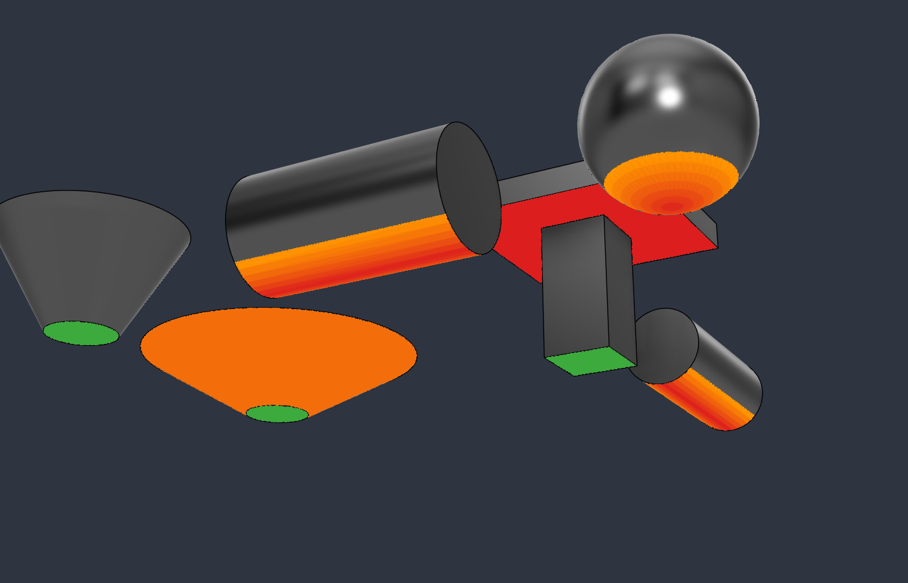
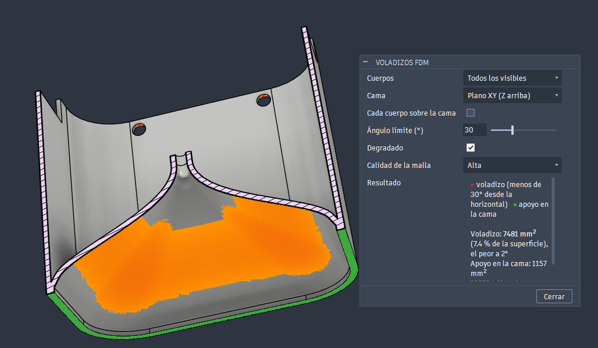
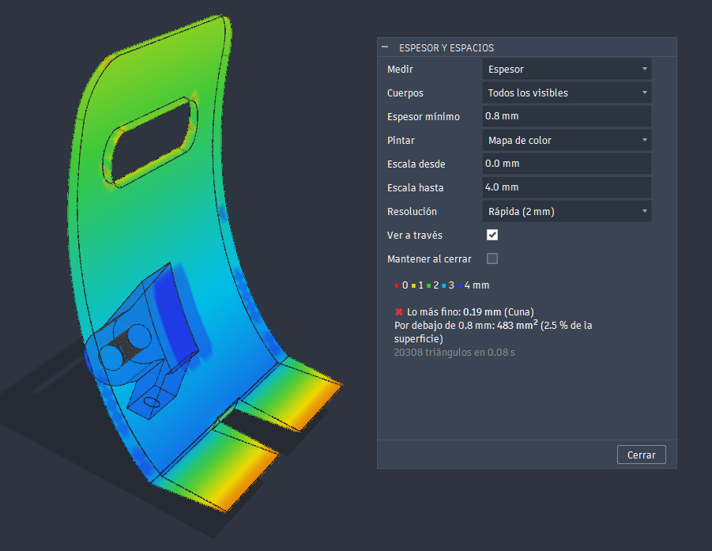
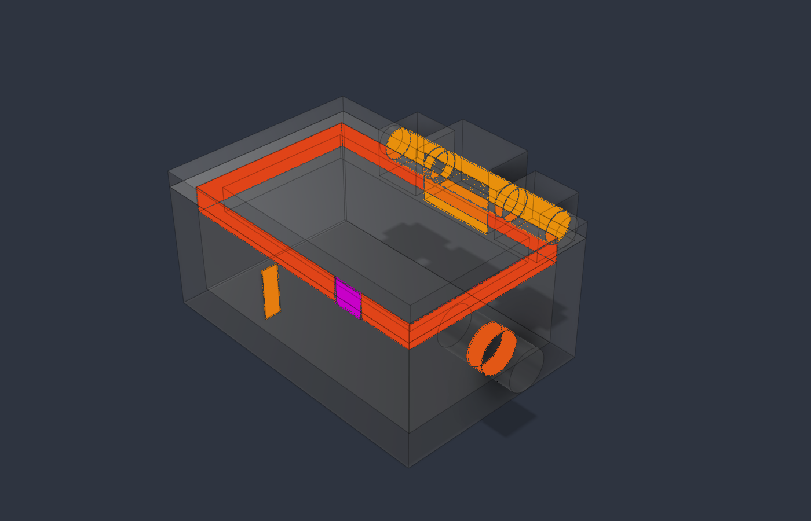

# FDM overhangs (Fusion 360 add-in)

[Español](README.md) · **English**

Paints over the model what will need support, like a slicer's support preview:

- **red → orange**: faces pointing down at less than the limit angle from the horizontal. Pure red is a flat ceiling; orange is just below the limit;
- **green**: what rests on the bed.

The design is not modified: these are custom graphics, they don't go into the timeline and they disappear when the dialog is closed.

It is in **DESIGN > INSPECT > FDM overhangs**. The same panel has a second button, [Thickness and gaps](#thickness-and-gaps), which paints the wall thickness or the gap between surfaces.



Test parts seen from below with the limit at 45°: the top of the T is a flat ceiling (red), the lying cylinder and the sphere go from red to orange, the cone with its wall at 30° from the horizontal is orange and the 60° one is not marked.



A real part seen from below and cut with a section analysis, with the limit at 30° and *High* mesh quality: the inner vault is orange and the rim resting on the bed is green. The dialog gives the overhang area, the worst angle and the area on the bed.

## Dialog

| Field | What it does |
|---|---|
| Bodies | *All visible* (including those in occurrences and mesh bodies) or *Selected* |
| Bed | *XY plane (Z up)*, *XZ plane (Y up)* or *Selected planar face*: the face that goes on the bed, like the slicers' "place on face". Defaults to Fusion's modeling orientation |
| Each body on the bed | Each body rests on its own lowest point. Unchecked, the bed is the lowest point of all of them (useful for an assembly) |
| Limit angle (°) | Measured from the horizontal, as in PrusaSlicer and Orca: 45° for most materials; 30° if the printer and material can handle it |
| Gradient | Red → orange by inclination; unchecked, everything red |
| Mesh quality | *Low*, *Normal* or *High* tessellation. Curves are classified per triangle: higher quality gives a finer edge to the marked area |
| Keep when closed | The layer stays after closing the dialog and is recomputed after every command that may change the model. To remove it, open the dialog again and uncheck this. It only lasts while the design is open: it is not saved in the file |

**Result** shows the overhang area (total, percentage of the surface and per body), the angle of the worst overhang and the area on the bed, with a warning if nothing rests flat on it.

Faces exactly at the limit (a teardrop or a chamfer at exactly 45° with the limit at 45°) are not marked: there is a half-degree margin.

## Thickness and gaps

Second button, in **DESIGN > INSPECT > Thickness and gaps**. Paints the wall thickness or the gap between surfaces, from red (narrow) to blue (wide), or only what is below the minimum, and gives the narrowest point of each body.



Test part with the scale from 0 to 4 mm: fins from 0.4 to 3.2 mm (orange to light blue), a wedge fin from 2.0 to 0.4 mm and a tube with a 0.8 wall; the 3.2 and 4 mm bases are light blue and blue.

| Field | What it does |
|---|---|
| Measure | *Thickness* or *Gap* |
| Bodies | *All visible* or *Selected*. Surfaces are not measured. With *Selected*, gaps are only measured between them |
| Minimum thickness / Minimum gap | What is below it is counted in the result (area and ✖). For example a 0.8 mm wall, two lines of a 0.4 nozzle. Each measure keeps its own value |
| Paint | *Colour map* or *Only what is below the minimum* (in red) |
| Scale from / to | Values of the red and the blue in the colour map. Each measure keeps its own |
| Resolution | Maximum side of the triangles used to measure: *Fast (2 mm)*, *Normal (1 mm)* or *Fine (0.5 mm)* |
| See through | Makes the measured bodies transparent while the dialog is open, to see what is inside. They go back to their opacity when it is closed, also with *Keep when closed* |
| Keep when closed | The layer stays after closing the dialog until one of the bodies changes; then it is removed and the dialog has to be opened again (it cannot be recomputed outside the dialog). It is not saved in the file |

**Result** shows the thinnest point (and its body), the area below the minimum thickness and, with several bodies, both values for each.

**How it measures thickness:** from the centre of each triangle it casts a ray inwards, perpendicular to the surface, up to the opposite wall. Fusion only casts rays against mesh bodies, so for solids it creates a temporary one inside the preview and deletes it at once: nothing is left in the design or the timeline. It does not use the API's `PolygonMesh.wallThickness`: it measures per node and gives almost 0 on curved edges (0.03 mm on the rim of a 0.8 tube).

**Limits:**

- The ray cast from the edge face of a wall runs along it, not across it. To correct it, each triangle takes the thinnest value of those it touches along a convex edge, so the edge of a 0.4 fin comes out as 0.4. On wide edge faces, several rows of triangles across, only the first row is corrected: the middle can come out thicker than it is.
- Curved walls measure a little less because of the mesh (0.79 on a 0.8 tube).
- Engraved or embossed text has very thin ridges between strokes and comes out as the thinnest part of the piece. That is real: they do not print well with a 0.4 nozzle.

### Measuring the gap

With **Measure: Gap**, the ray goes outwards and measures the air up to whatever each face has in front of it: narrow slots and holes in the same body, or clearances with another body.



With **See through** and the scale from 0 to 2 mm: the lid lip 0.1 mm from the wall and the shaft at 0.15 mm, in reddish orange; the 0.25 slot and the hinge pin at 0.3, in orange; a stud going 0.2 mm into the wall, in magenta.

- Only what fits in the scale is painted. Faces with nothing in front of them or further away are not painted, although the result still gives the minimum.
- Faces that touch (up to 0.01 mm) are not painted: they are given as the area in contact.
- Overlapping bodies are magenta and are given as **interference**, with the bodies involved.
- There is a 0.01 mm margin with the minimum gap, which is the measuring error between two curves: an exact 0.1 clearance is not marked.
- Narrow gaps are usually inside and cannot be seen from outside: that is what **See through** is for. A section barely helps: the walls of a narrow slit are edge-on and cannot be seen. Hiding a body does not work either: with *All visible* it is no longer measured.
- The ray leaves each face perpendicularly, so an edge passing close to another face without having it in front may go unmeasured: the real minimum may be somewhat smaller.

## Installation

### Windows

1. Download `FDMOverhang-<version>.zip` from the [Releases](https://github.com/buho29/fdm-overhang/releases) and unzip all of it.
2. Double-click `instalar.bat`. It copies the `FDMOverhang` folder into Fusion's add-ins folder and needs no administrator rights.
3. In Fusion: **Utilities > Add-ins** (Shift+S) > *FDMOverhang* > **Run**, and tick *Run on Startup*.

To update, run the new version's `instalar.bat`: the last dialog values are kept. To remove it, use `desinstalar.bat`. Don't use them on a machine with the `install.ps1` development install: you would get the add-in twice.

### Mac

Copy the `FDMOverhang` folder from the zip to `~/Library/Application Support/Autodesk/Autodesk Fusion 360/API/AddIns/`.

### From the repo (development)

With Fusion closed:

```powershell
powershell -ExecutionPolicy Bypass -File install.ps1
```

It registers the repo folder in Fusion's add-in list with *Run on startup*. It can also be added by hand: **Utilities > Add-ins** (Shift+S) > **+** > this folder.

## How it works

1. Tessellates each body (`MeshManager`; mesh bodies use their own mesh) and moves it to root coordinates if it is in an occurrence.
2. Classifies each triangle by the average normal of its vertices (the surface normal): if it points down, its inclination from the horizontal is `acos(-n·up)`.
3. Paints the marked triangles with a `CustomGraphicsMesh` with per-vertex colours. Fusion draws the body with its own mesh, so the layer is lifted off the surface, along the normal, a little more than the larger of the two tolerances (that mesh's and the analysis one's): otherwise it is half buried and shows up in patches. Unmarked areas keep the body's normal appearance.

The classification is in [overhang/analysis.py](overhang/analysis.py), with no Fusion dependencies. Its tests:

```
python -m unittest discover -s tests
```

## License

MIT
