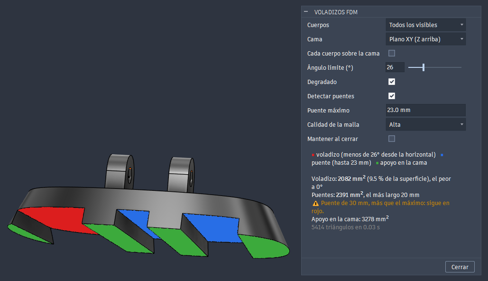
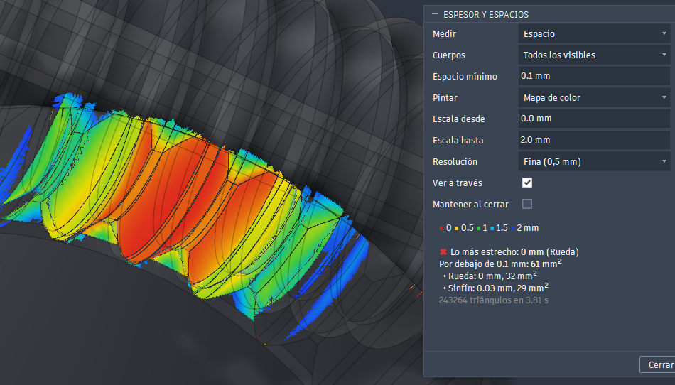

# FDM overhangs (Fusion 360 add-in)

[Español](README.md) · **English**

Paints over the model what will need support, like a slicer's support preview:

- **red → orange**: faces pointing down at less than the limit angle from the horizontal. Pure red is a flat ceiling; orange is just below the limit;
- **blue**: bridges, flat ceilings spanning two walls that are not over the maximum;
- **green**: what rests on the bed.

The design is not modified: these are custom graphics, they don't go into the timeline and they disappear when the dialog is closed.

It is in **DESIGN > INSPECT > FDM overhangs**. The same panel has two more buttons:

- [Thickness and gaps](#thickness-and-gaps) paints the wall thickness or the gap between surfaces.
- [Send to slicer](#send-to-slicer) sends one or several bodies to OrcaSlicer or Bambu Studio, with the face that goes on the bed and where to enforce or block the seam and supports.


Test parts seen from below with the limit at 45°: the top of the T is a flat ceiling (red), the lying cylinder and the sphere go from red to orange, the cone with its wall at 30° from the horizontal is orange and the 60° one is not marked.


A real part seen from below and cut with a section analysis, with the limit at 30° and *High* mesh quality: the inner vault is orange and the rim resting on the bed is green. The dialog gives the overhang area, the worst angle and the area on the bed.



A phone stand seen from below: the two bridges up to 23 mm are blue; the 30 mm one stays red and the result warns about it. What rests on the bed is green.

## Dialog

| Field | What it does |
|---|---|
| Bodies | *All visible* (including those in occurrences and mesh bodies) or *Selected* |
| Bed | *XY plane (Z up)*, *XZ plane (Y up)* or *Selected planar face*: the face that goes on the bed, like the slicers' "place on face". Defaults to Fusion's modeling orientation |
| Each body on the bed | Each body rests on its own lowest point. Unchecked, the bed is the lowest point of all of them (useful for an assembly) |
| Limit angle (°) | Measured from the horizontal, as in PrusaSlicer and Orca: 45° for most materials; 30° if the printer and material can handle it |
| Gradient | Red → orange by inclination; unchecked, everything red |
| Detect bridges | Paints flat ceilings spanning walls in blue and takes their area out of the overhang. Unchecked, they show as overhangs |
| Maximum bridge | Span above which a bridge goes back to red, with a warning. 23 mm by default |
| Mesh quality | *Low*, *Normal* or *High* tessellation. Curves are classified per triangle: higher quality gives a finer edge to the marked area |
| Keep when closed | The layer stays after closing the dialog and is recomputed after every command that may change the model. It is removed when the dialog is opened again. It only lasts while the design is open: it is not saved in the file |

The dialog opens without computing anything: set the fields and press **Analyse**. From then on, whatever does not need computing again (the angle, the gradient, the bridges…) updates at once; if something that does need it changes (the quality or the bodies), the layer goes away until you press it again.

**Result** shows the overhang area (total, percentage of the surface and per body), the angle of the worst overhang, the area and longest span of the bridges and the area on the bed, with a warning if nothing rests flat on it.

Faces exactly at the limit (a teardrop or a chamfer at exactly 45° with the limit at 45°) are not marked: there is a half-degree margin.

**What counts as a bridge:** a horizontal ceiling whose lines, in some direction, go from one wall to another; the span is the longest stretch in the shortest direction. Some of them may end at a free edge, like at the end of a window in a curved wall: at least half must go from wall to wall. A ceiling supported on a single side or on two adjacent sides, or the top of a T, stays red. Arched or tilted ceilings do not count either, nor does a support that is itself an overhang or part of another body.

## Thickness and gaps

Second button, in **DESIGN > INSPECT > Thickness and gaps**. Paints the wall thickness or the gap between surfaces, from red (narrow) to blue (wide), or only what is below the minimum, and gives the narrowest point of each body.


The phone stand with the scale from 0 to 4 mm and **See through**: the curved wall goes from blue to green as it thins towards the top, and the wedge tips of the base reach orange. The thinnest point, 0.19 mm, is in the cradle.

| Field | What it does |
|---|---|
| Measure | *Thickness* or *Gap* |
| Bodies | *All visible* or *Selected*. Surfaces are not measured. With *Selected*, gaps are only measured between them |
| Minimum thickness / Minimum gap | What is below it is counted in the result (area and ✖). For example a 0.8 mm wall, two lines of a 0.4 nozzle. Each measure keeps its own value |
| Paint | *Colour map* or *Only what is below the minimum* (in red) |
| Scale from / to | Values of the red and the blue in the colour map. Each measure keeps its own |
| Resolution | Maximum side of the triangles used to measure: *Fast (2 mm)*, *Normal (1 mm)* or *Fine (0.5 mm)*. In mesh bodies (an STL) their triangles are split down to that size |
| See through | Makes the measured bodies transparent while the dialog is open, to see what is inside. They go back to their opacity when it is closed, also with *Keep when closed* |
| Keep when closed | The layer stays after closing the dialog until one of the bodies changes or the dialog is opened again (it cannot be recomputed outside the dialog). It is not saved in the file |

As in FDM overhangs, nothing is measured until you press **Analyse**. Measurements are kept while the dialog is open: the scale, the minimum or *Paint* update at once, and a resolution or bodies not measured yet wait for the button.

**Result** shows the thinnest point (and its body), the area below the minimum thickness and, with several bodies, both values for each.

**How it measures thickness:** from the centre of each triangle it casts a ray inwards, perpendicular to the surface, up to the opposite wall. Fusion only casts rays against mesh bodies, so for solids it creates a temporary one inside the preview and deletes it at once: nothing is left in the design or the timeline. It does not use the API's `PolygonMesh.wallThickness`: it measures per node and gives almost 0 on curved edges (0.03 mm on the rim of a 0.8 tube).

**Limits:**

- The ray cast from the edge face of a wall runs along it, not across it. To correct it, each triangle takes the thinnest value of those it touches along a convex edge, so the edge of a 0.4 fin comes out as 0.4. On wide edge faces, several rows of triangles across, only the first row is corrected: the middle can come out thicker than it is.
- Curved walls measure a little less because of the mesh (0.79 on a 0.8 tube).
- Engraved or embossed text has very thin ridges between strokes and comes out as the thinnest part of the piece. That is real: they do not print well with a 0.4 nozzle.

### Measuring the gap

With **Measure: Gap**, the ray goes outwards and measures the air up to whatever each face has in front of it: narrow slots and holes in the same body, or clearances with another body.


With **See through** and the scale from 0 to 2 mm: the lid lip 0.1 mm from the wall and the shaft at 0.15 mm, in reddish orange; the 0.25 slot and the hinge pin at 0.3, in orange; a stud going 0.2 mm into the wall, in magenta; the faces where the lid rests on the box, in white.



A worm and its wheel, generated with [WormGear](https://github.com/buho29/wormgear), in their working position: the air between the flanks closes from blue to red on the meshing teeth.

- Only what fits in the scale is painted. Faces with nothing in front of them or further away are not painted, although the result still gives the minimum.
- Faces that touch (up to 0.01 mm) are white and are given as the area in contact. They are usually inside, so they are easier to see with **See through**. The border follows the triangles: it is cleaner at a finer resolution.
- Overlapping bodies are magenta and are given as **interference**, with the bodies involved.
- There is a 0.01 mm margin with the minimum gap, which is the measuring error between two curves: an exact 0.1 clearance is not marked.
- Narrow gaps are usually inside and cannot be seen from outside: that is what **See through** is for. A section barely helps: the walls of a narrow slit are edge-on and cannot be seen. Hiding a body does not work either: with *All visible* it is no longer measured.
- The ray leaves each face perpendicularly, so an edge passing close to another face without having it in front may go unmeasured: the real minimum may be somewhat smaller.

## Send to slicer

Third button, in **DESIGN > INSPECT > Send to slicer**. Takes a part from Fusion to the slicer with what you would otherwise do by hand in the slicer: the face that goes on the bed, where the seam may or may not go and where to enforce or block supports. You choose them on the model's faces and edges, and the 3MF comes out oriented and painted for OrcaSlicer or Bambu Studio.

| Field | What it does |
|---|---|
| Send | *This body*, in its own 3MF, or *Several on one plate*: all those ticked with *Include on the plate*, in a single 3MF |
| Body | The body being shown and set up. Those on the plate are marked with ✔ |
| Include on the plate | This body goes on the plate |
| Bed | *XY plane (Z up)*, *XZ plane (Y up)* or *Selected planar face*, chosen in *Face on the bed* |
| Seam: Enforce on / Block on | Edges or faces where the seam should go, or where it must not. An edge can only enforce the seam if it rises relative to the layers |
| Supports: Enforce on / Block on | Faces where supports are enforced, or not allowed. Only what faces down once the part is oriented counts |
| STL mesh | Maximum distance between the triangles and the surface: from *Low (0.05 mm)* to *Very high (0.003 mm)*. *High* is enough for printing; finer meshes take longer to process and to open |
| Open in | *OrcaSlicer*, *Bambu Studio* or *Do not open*. The 3MF is prepared for the chosen slicer: each one needs its own |

While the dialog is open, what you choose is painted over the model: enforced seam in cyan, blocked seam in orange, enforced supports in green and blocked supports in red. The choices for each body are saved in the design and come back when the dialog is opened again, also after closing and reopening the file.

**Send** asks where to save the 3MF. Next to it go each body's STL and part file, the slicer-paint log and, with several bodies, the plate file. Fusion stays free while slicer-paint works. When it finishes, the slicer opens, or a message appears if something fails.

- **It needs [slicer-paint](#slicer-paint-for-send-to-slicer)**, which orients the part, paints the seam and supports and writes the 3MF. Without it, only the STL and the part file are saved, with the command to build the 3MF by hand.
- **Several bodies:** each one is oriented with its own bed and carries its own choices. They are laid out in rows on the bed; if they don't fit, a warning says to arrange them in the slicer.
- **If you send again to the same 3MF** after saving it in the slicer, its print options are kept: the project (printer, filaments and process), each part's settings, such as its filament, walls or support type, and the plate's. Geometry, orientation, position and painting are generated again.
- **Bambu Studio:** the 3MF carries a complete P1S project with 5 filaments, because Bambu Studio drops each part's settings if the project is not complete. For another printer, save it once from Bambu Studio with yours: later sends keep it.
- Bodies inside moved or rotated occurrences are exported in place, and the STL is checked against the body before slicer-paint runs.

The slicer-paint details, such as its options and the part file format, are in [slicer-paint/README.md](slicer-paint/README.md) (in Spanish).

## Installation

### Windows

1. Download `FDMOverhang-<version>.zip` from the [Releases](https://github.com/buho29/fdm-overhang/releases) and unzip all of it.
2. Double-click `instalar.bat`. It copies the `FDMOverhang` folder into Fusion's add-ins folder and needs no administrator rights.
3. In Fusion: **Utilities > Add-ins** (Shift+S) > *FDMOverhang* > **Run**, and tick *Run on Startup*.

To update, run the new version's `instalar.bat`: the last dialog values are kept. To remove it, use `desinstalar.bat`. Don't use them on a machine with the `install.ps1` development install: you would get the add-in twice.

### Mac

Copy the `FDMOverhang` folder from the zip to `~/Library/Application Support/Autodesk/Autodesk Fusion 360/API/AddIns/`.

### slicer-paint (for *Send to slicer*)

Optional: without it, *Send to slicer* only saves the STL and the part file. It needs Python 3.10 or later and [pipx](https://pipx.pypa.io):

```powershell
pipx install "git+https://github.com/buho29/fdm-overhang#subdirectory=slicer-paint"
```

The add-in looks for it on the PATH. If it is not there, the first time you send a part it asks where `slicer-paint.exe` is and remembers it. With pipx on Windows it is usually in `%USERPROFILE%\.local\bin`.

### From the repo (development)

With Fusion closed:

```powershell
powershell -ExecutionPolicy Bypass -File install.ps1
```

It registers the repo folder in Fusion's add-in list with *Run on startup*. It can also be added by hand: **Utilities > Add-ins** (Shift+S) > **+** > this folder.

slicer-paint lives in [slicer-paint/](slicer-paint/). If you install it there, in its own `.venv`, the add-in finds it without asking:

```powershell
cd slicer-paint
python -m venv .venv
.venv\Scripts\python.exe -m pip install -e .[dev]
```

## How it works

1. Tessellates each body (`MeshManager`; mesh bodies use their own mesh) and moves it to root coordinates if it is in an occurrence.
2. Classifies each triangle by the average normal of its vertices (the surface normal): if it points down, its inclination from the horizontal is `acos(-n·up)`.
3. Paints the marked triangles with a `CustomGraphicsMesh` with per-vertex colours. Fusion draws the body with its own mesh, so the layer is lifted off the surface, along the normal, a little more than the larger of the two tolerances (that mesh's and the analysis one's): otherwise it is half buried and shows up in patches. Unmarked areas keep the body's normal appearance.

The classification is in [overhang/analysis.py](overhang/analysis.py), with no Fusion dependencies. Its tests:

```
python -m unittest discover -s tests
```

## License

MIT
