# Voladizos FDM (add-in de Fusion 360)

**Español** · [English](README.en.md)

Pinta encima del modelo lo que va a necesitar soporte, como la vista de soportes de un laminador:

- **rojo → naranja**: lo que mira hacia abajo con menos del ángulo límite desde la horizontal. El rojo puro es un techo plano y el naranja está justo por debajo del límite;
- **azul**: los puentes, techos planos tendidos entre dos paredes que no pasan del máximo;
- **verde**: lo que apoya en la cama.

No modifica el diseño: son gráficos personalizados, no entran en la línea de tiempo y desaparecen al cerrar el diálogo.

Está en **DISEÑO > INSPECCIONAR > Voladizos FDM**. En el mismo panel hay otros dos botones:

- [Espesor y espacios](#espesor-y-espacios) pinta el espesor de las paredes o el espacio entre superficies.
- [Enviar al laminador](#enviar-al-laminador) manda uno o varios cuerpos a OrcaSlicer o Bambu Studio, con la cara que va sobre la cama, dónde forzar o prohibir la costura y los soportes y, si quieres, los colores de las caras para imprimir con varios filamentos.

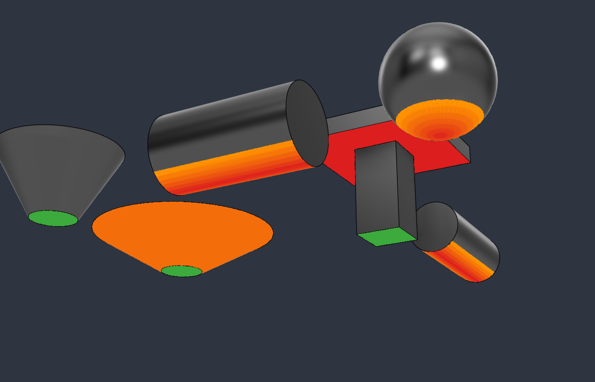

Piezas de prueba vistas desde abajo con el límite en 45°: el tablero de la T es un techo plano (rojo), el cilindro tumbado y la esfera pasan de rojo a naranja, el cono con la pared a 30° de la horizontal sale naranja y el de 60° no se marca.

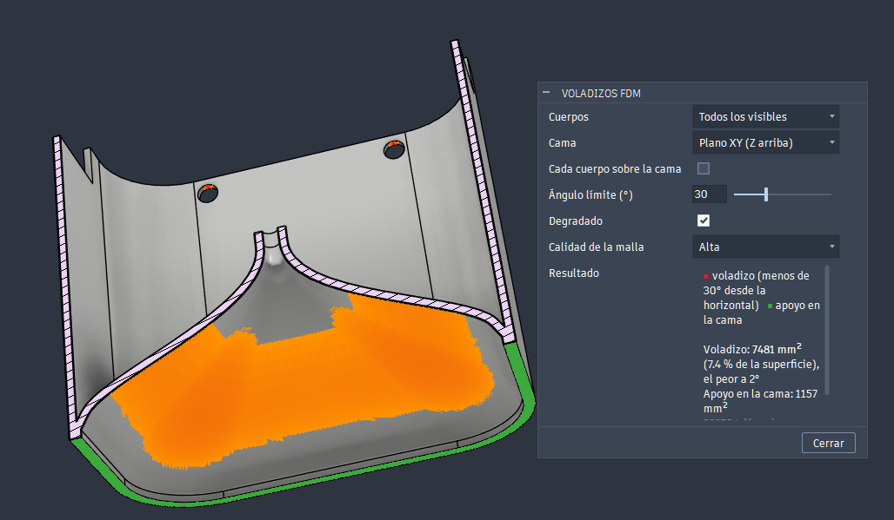

Una pieza real vista desde abajo y cortada con un análisis de sección, con el límite en 30° y la malla en calidad *Alta*: la bóveda interior sale en naranja y el borde que apoya en la cama, en verde. El diálogo da el área en voladizo, el peor ángulo y el área de apoyo.

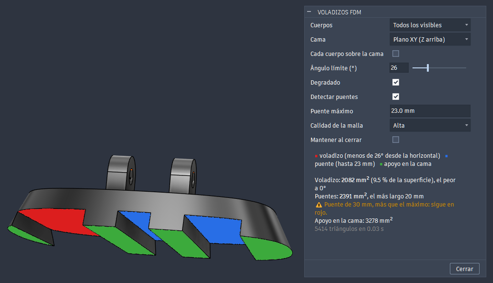

Un soporte de móvil visto desde abajo: los dos puentes que no pasan de 23 mm salen en azul; el de 30 mm sigue en rojo y el resultado avisa. Lo que apoya en la cama, en verde.

## Diálogo

| Campo | Qué hace |
|---|---|
| Cuerpos | *Todos los visibles* (también los de las ocurrencias y los de malla) o *Elegidos* |
| Cama | *Plano XY (Z arriba)*, *Plano XZ (Y arriba)* o *Cara plana elegida*: la cara que irá sobre la cama, como el "colocar en cara" de los laminadores. Por defecto, según la orientación de modelado de Fusion |
| Cada cuerpo sobre la cama | Cada cuerpo se apoya en su punto más bajo. Sin marcar, la cama es el punto más bajo de todos (útil para un conjunto montado) |
| Ángulo límite (°) | Medido desde la horizontal, como en PrusaSlicer y Orca: 45° para la mayoría de materiales; 30° si la impresora y el material lo aguantan |
| Degradado | Rojo → naranja según la inclinación; sin marcar, todo rojo |
| Detectar puentes | Pinta en azul los techos planos tendidos entre paredes y descuenta su área del voladizo. Sin marcar, salen como voladizo |
| Puente máximo | Luz a partir de la cual un puente vuelve a salir en rojo, con un aviso. Por defecto 23 mm |
| Calidad de la malla | Teselado *Baja*, *Normal* o *Alta*. Las curvas se clasifican por triángulos: con más calidad, el borde de la zona marcada es más fino |
| Mantener al cerrar | La capa se queda al cerrar el diálogo y se recalcula cada vez que termina un comando que pueda cambiar el modelo. Se quita al volver a abrir el diálogo. Solo dura mientras el diseño está abierto: no se guarda en el archivo |

El diálogo se abre sin calcular nada: se ajustan los campos y se pulsa **Analizar**. A partir de ahí, lo que no necesita calcular de nuevo (el ángulo, el degradado, los puentes…) se actualiza al momento; si cambia algo que sí lo necesita (la calidad o los cuerpos), la capa se quita hasta volver a pulsar.

En **Resultado** salen el área en voladizo (total, porcentaje de la superficie y por cuerpo), el ángulo del peor voladizo, el área y la luz más larga de los puentes y el área apoyada en la cama, con un aviso si nada apoya en plano.

Lo que está justo en el límite (una gota o un chaflán a 45° exactos con el límite en 45°) no se marca: hay medio grado de margen.

**Qué cuenta como puente:** un techo horizontal cuyas líneas, en alguna dirección, van de una pared a otra; la luz es el tramo más largo en la dirección más corta. Se admite que algunas acaben en un borde libre, como en el extremo de una ventana en una pared curva: tiene que haber al menos la mitad de pared a pared. Un techo apoyado por un solo lado o por dos lados contiguos, o el tablero de una T, sigue en rojo. Tampoco cuentan los techos en arco o inclinados, ni un apoyo que sea a su vez voladizo o de otro cuerpo.

## Espesor y espacios

Segundo botón, en **DISEÑO > INSPECCIONAR > Espesor y espacios**. Pinta el espesor de las paredes o el espacio entre superficies, de rojo (estrecho) a azul (ancho), o solo lo que no llega al mínimo, y dice cuál es el punto más estrecho de cada cuerpo.

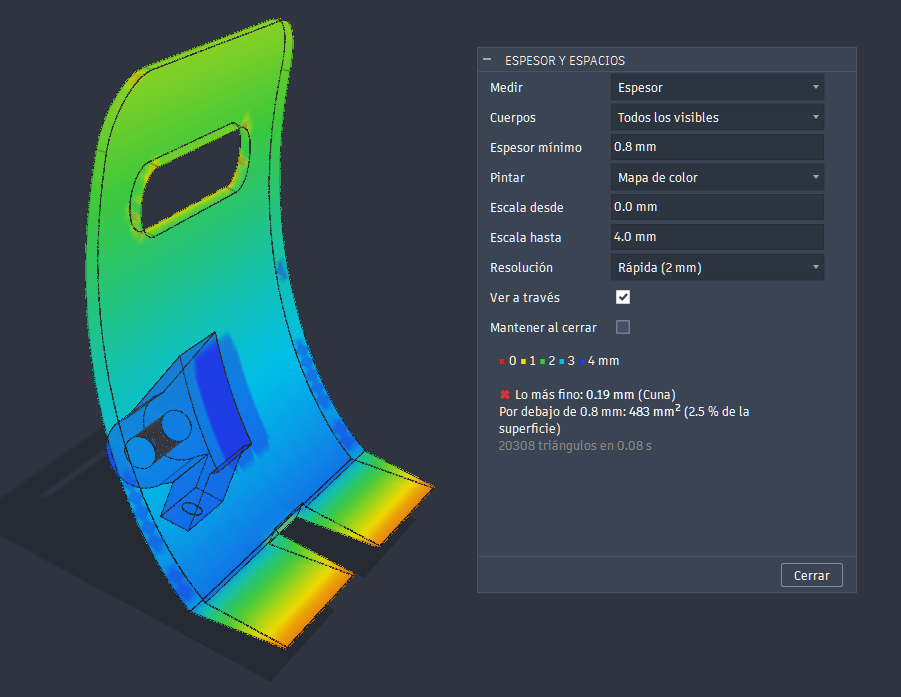

El soporte de móvil con la escala de 0 a 4 mm y **Ver a través**: la pared curva pasa de azul a verde según se adelgaza hacia arriba y las puntas en cuña de la base llegan a naranja. Lo más fino, 0,19 mm, está en la cuna.

| Campo | Qué hace |
|---|---|
| Medir | *Espesor* o *Espacio* |
| Cuerpos | *Todos los visibles* o *Elegidos*. Las superficies no se miden. Con *Elegidos*, los espacios solo se miden entre ellos |
| Espesor mínimo / Espacio mínimo | Lo que no llega se cuenta en el resultado (área y ✖). Por ejemplo 0,8 mm de pared, dos pasadas de una boquilla de 0,4. Cada medida guarda su propio valor |
| Pintar | *Mapa de color* o *Solo lo que no llega al mínimo* (en rojo) |
| Escala desde / hasta | Medidas del rojo y del azul en el mapa de color. Cada medida guarda las suyas |
| Resolución | Lado máximo de los triángulos con los que se mide: *Rápida (2 mm)*, *Normal (1 mm)* o *Fina (0,5 mm)*. En los cuerpos de malla (un STL) se parten sus triángulos hasta ese tamaño |
| Ver a través | Pone los cuerpos medidos en transparencia mientras el diálogo está abierto, para ver lo que queda por dentro. Al cerrar vuelven a su opacidad, también con *Mantener al cerrar* |
| Mantener al cerrar | La capa se queda al cerrar el diálogo hasta que cambie alguno de los cuerpos o se vuelva a abrir el diálogo (fuera del diálogo no se puede recalcular). No se guarda en el archivo |

Igual que en Voladizos FDM, no se mide nada hasta pulsar **Analizar**. Las medidas se guardan mientras el diálogo está abierto: la escala, el mínimo o *Pintar* se actualizan al momento, y una resolución o unos cuerpos que aún no se han medido esperan al botón.

En **Resultado** salen lo más fino (y de qué cuerpo), el área por debajo del espesor mínimo y, con varios cuerpos, los dos datos de cada uno.

**Cómo mide el espesor:** desde el centro de cada triángulo lanza un rayo hacia dentro, perpendicular a la superficie, hasta la pared de enfrente. Fusion solo lanza rayos contra cuerpos de malla, así que en los sólidos crea uno temporal dentro de la vista previa y lo borra en seguida: no queda nada en el diseño ni en la línea de tiempo. No usa `PolygonMesh.wallThickness` de la API: mide por nodos y en las aristas curvas da casi 0 (0,03 mm en el canto de un tubo de 0,8).

**Límites:**

- El rayo que sale del canto de una pared la recorre a lo largo, no a lo ancho. Para corregirlo, cada triángulo toma el valor más fino de los que tocan con él en una arista convexa, así que el canto de una aleta de 0,4 sale de 0,4. En cantos anchos, de varias filas de triángulos, solo se corrige la primera fila: el centro puede salir más grueso de lo que es.
- Las paredes curvas miden un poco menos por la malla (0,79 en un tubo de 0,8).
- El texto grabado o en relieve tiene tabiques muy finos entre trazos y sale como lo más fino de la pieza. Es real: con una boquilla de 0,4 no se imprimen bien.

### Medir el espacio

Con **Medir: Espacio**, el rayo sale hacia fuera y mide el aire hasta lo que cada cara tiene delante: ranuras y agujeros estrechos del mismo cuerpo, u holguras con otro cuerpo.

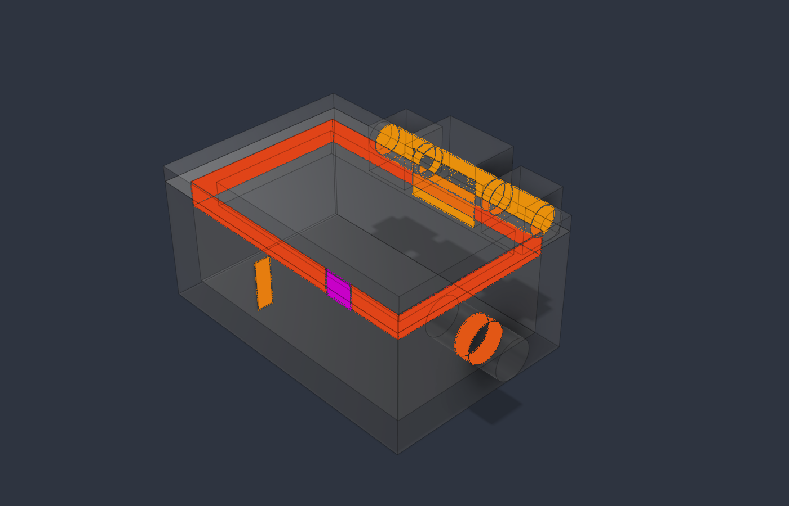

Con **Ver a través** y la escala de 0 a 2 mm: el reborde de la tapa a 0,1 mm de la pared y el eje a 0,15 mm, en rojo anaranjado; la ranura de 0,25 y el pasador de la bisagra a 0,3, en naranja; un tetón metido 0,2 mm en la pared, en magenta; las caras donde la tapa apoya en la caja, en blanco.

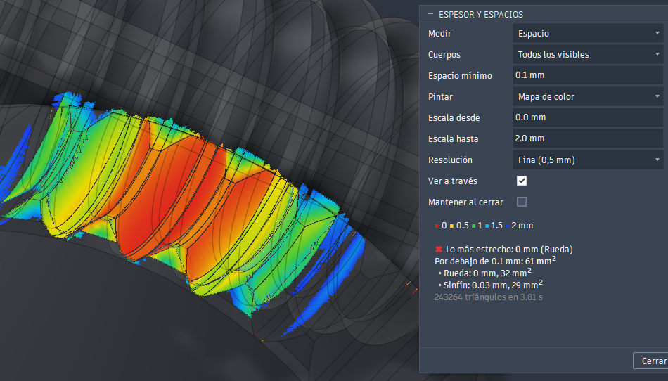

Un sinfín y su rueda, generados con [WormGear](https://github.com/buho29/wormgear), en su posición de trabajo: el aire entre los flancos se cierra de azul a rojo en los dientes que engranan.

- Solo se pinta lo que entra en la escala. Lo que no tiene nada delante o queda más lejos no se pinta, aunque el resultado da el mínimo igualmente.
- Las caras que se tocan (hasta 0,01 mm) salen en blanco y se dan como área en contacto. Suelen quedar por dentro, así que se ven mejor con **Ver a través**. El borde va por triángulos: sale más limpio con una resolución más fina.
- Los cuerpos que se solapan salen en magenta y se dan como **interferencia**, con los cuerpos implicados.
- Hay 0,01 mm de margen con el espacio mínimo, porque es el error de la medida entre dos curvas: una holgura justa de 0,1 no se marca.
- Lo estrecho suele estar por dentro y no se ve desde fuera: para eso está **Ver a través**. Una sección apenas ayuda: las paredes de una rendija estrecha quedan de canto y no se ven. Ocultar un cuerpo tampoco sirve: con *Todos los visibles* deja de medirse.
- El rayo sale perpendicular a cada cara, así que una arista que pasa cerca de otra cara sin tenerla delante puede quedar sin medir: el mínimo real puede ser algo menor.

## Enviar al laminador

Tercer botón, en **DISEÑO > INSPECCIONAR > Enviar al laminador**. Lleva una pieza de Fusion al laminador con lo que en el laminador se hace a mano: la cara que va sobre la cama, dónde poner o no la costura y dónde forzar o bloquear los soportes. Se elige sobre las caras y aristas del modelo, y el 3MF sale orientado y pintado para OrcaSlicer o Bambu Studio.

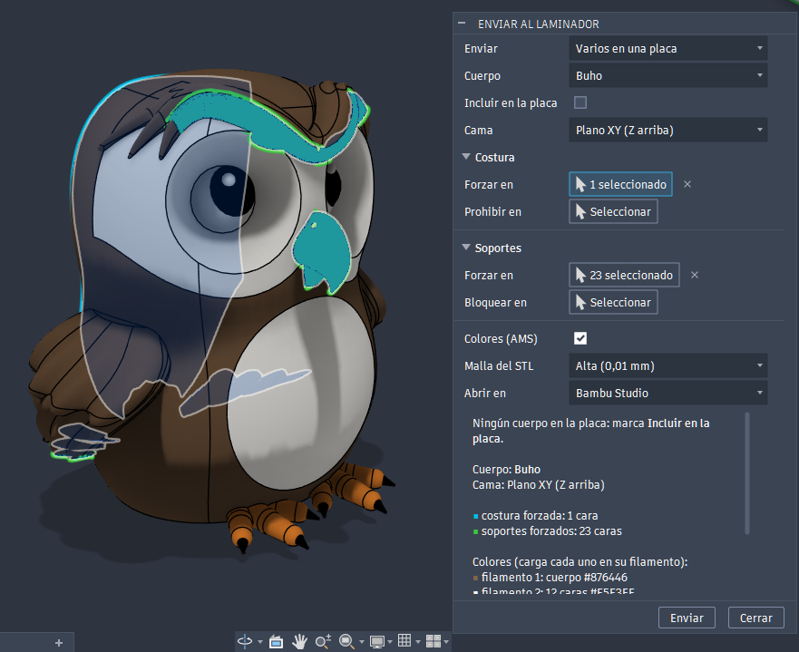

El búho de demostración, en 4 colores (uno por bobina del AMS), sobre el plano XY. La costura se fuerza en la cara de la espalda (cian) y los soportes solo donde hacen falta, en 23 caras (verde): la ceja, el pico y las puntas de las alas que cuelgan sobre la cama. Con *Colores (AMS)*, *Resultado* lista cada color con su filamento.

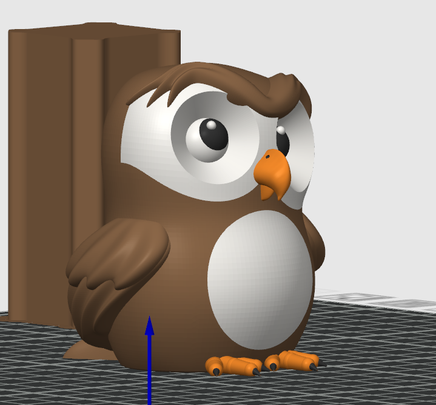

El 3MF en Bambu Studio: cada cara va al filamento de su color, con la torre de purga. En el laminador se ven los colores de los filamentos del proyecto, no los aspectos de Fusion.

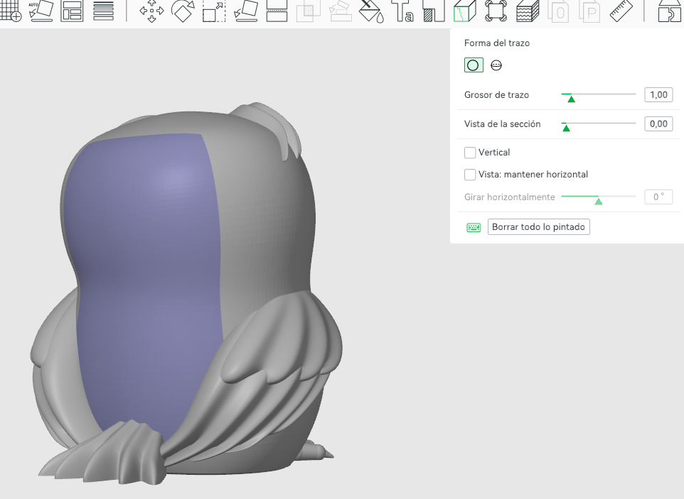

Visto por detrás, con la herramienta de pintar la costura de Bambu Studio: la cara de la espalda llega pintada para forzar la costura.

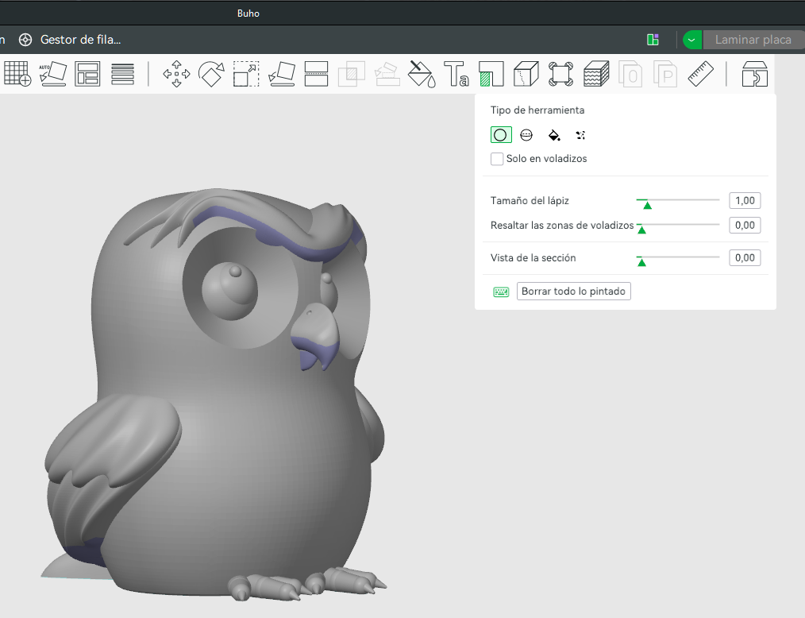

Y con la de pintar soportes: la ceja, el pico y las puntas de las alas llegan pintados para forzar soportes.

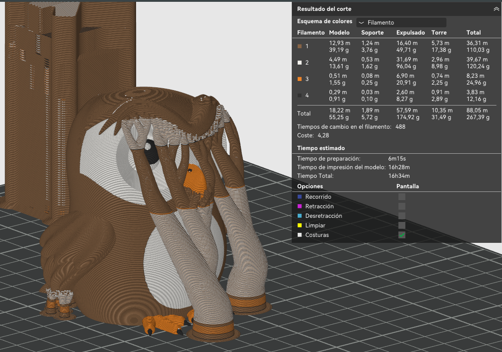

Laminado con soportes en árbol (manual) y *Solo en la placa*: los árboles salen de la cama, rodean el cuerpo y llegan a la ceja y al pico. Fuera de lo pintado no hay soportes.

| Campo | Qué hace |
|---|---|
| Enviar | *Este cuerpo*, en su propio 3MF, o *Varios en una placa*: todos los marcados con *Incluir en la placa*, en un solo 3MF |
| Cuerpo | El cuerpo que se ve y se configura. Los que van en la placa llevan ✔ |
| Incluir en la placa | Este cuerpo entra en la placa |
| Cama | *Plano XY (Z arriba)*, *Plano XZ (Y arriba)* o *Cara plana elegida*, que se elige en *Cara sobre la cama* |
| Costura: Forzar en / Prohibir en | Aristas o caras donde poner la costura, o donde no puede ir. Una arista solo vale para forzarla si sube respecto a las capas |
| Soportes: Forzar en / Bloquear en | Caras donde forzar soportes, o donde no puede haberlos. Solo cuenta lo que mira hacia abajo con la pieza ya orientada |
| Colores (AMS) | Pinta cada cara con el filamento de su color, según los aspectos de Fusion. Cada color distinto va a un filamento: el del primer cuerpo es el 1 y los demás, por orden de aparición, también entre los cuerpos de una placa. La lista de colores y filamentos sale en *Resultado*. En Bambu Studio, el proyecto lleva un filamento por color, con su color: al imprimir, empareja cada uno con una bobina del AMS. En OrcaSlicer, carga cada color en su número |
| Malla del STL | Separación máxima entre los triángulos y la superficie: de *Baja (0,05 mm)* a *Muy alta (0,003 mm)*. *Alta* basta para imprimir; con más, la pieza tarda más en procesarse y en abrirse |
| Abrir en | *OrcaSlicer*, *Bambu Studio* o *No abrir*. El 3MF se prepara para el laminador elegido: cada uno necesita el suyo |

Mientras el diálogo está abierto, lo elegido se pinta encima del modelo: costura forzada en cian, prohibida en naranja, soportes forzados en verde y bloqueados en rojo. Lo elegido para cada cuerpo se guarda en el diseño y vuelve al abrir el diálogo, también después de cerrar y abrir el archivo.

Al pulsar **Enviar** se elige dónde guardar el 3MF. Al lado quedan el STL y el archivo de pieza de cada cuerpo, el log de slicer-paint y, con varios cuerpos, el archivo de placa. Mientras slicer-paint trabaja, Fusion sigue libre. Al acabar, se abre el laminador, o un aviso si algo falla.

- **Necesita [slicer-paint](#slicer-paint-para-enviar-al-laminador)**, que orienta la pieza, pinta la costura y los soportes y escribe el 3MF. Sin él, solo se guardan el STL y el archivo de pieza, con la orden para generar el 3MF a mano.
- **Varios cuerpos:** cada uno se orienta con su propia cama y lleva lo suyo. Se colocan en filas sobre la cama, y si no caben, se avisa para ordenarlos en el laminador.
- **Si vuelves a enviar al mismo 3MF** después de guardarlo en el laminador, se conservan sus opciones de impresión: el proyecto (impresora, filamentos y proceso), los ajustes de cada pieza, como su filamento, sus paredes o el tipo de soporte, y los de la placa. La geometría, la orientación, la posición y la pintura salen de nuevo.
- **Bambu Studio:** el 3MF lleva un proyecto completo de la P1S con 5 filamentos, porque Bambu Studio borra los ajustes de cada pieza si el proyecto no está completo. Para otra impresora, guárdalo una vez desde Bambu Studio con la tuya: los siguientes envíos la conservan.
- Los cuerpos dentro de ocurrencias movidas o giradas se exportan en su sitio, y se comprueba que el STL coincide con el cuerpo antes de lanzar slicer-paint.

Los detalles de slicer-paint, como sus opciones y el formato del archivo de pieza, están en [slicer-paint/README.md](slicer-paint/README.md).

### Desde un script (o desde Claude)

Lo mismo se puede hacer sin abrir el diálogo, con funciones del complemento: así lo usa Claude por un MCP de Fusion que ejecute Python. Guardan lo elegido igual que el diálogo, así que al abrirlo sale marcado y se puede corregir a mano. Las medidas van en mm, en las coordenadas del diseño.

```python
m = next(v for v in list(sys.modules.values()) if getattr(v, 'SL_CMD_ID', None) == 'buhoFdmSlicer')
m.analyze('Caja')                                        # voladizos, puentes y apoyo, en mm²
m.mark(m.edges_where('Caja', along='up', box=((None, 15, None), None)), 'seam_on')
m.mark(m.faces_where('Caja', overhang=True), 'support_on')
m.set_body('Caja', plate=True)
m.show()                                                 # pinta lo marcado, como el diálogo
m.send(None, r'C:\impresion\placa.3mf', open_in='orca')  # la placa con los marcados
m.send_status()
```

| Función | Qué hace |
|---|---|
| `marks(body, detail)` | Lo marcado en cada cuerpo: cama, placa y caras y aristas de cada papel |
| `mark(entities, role)` / `unmark(entities, role)` / `clear_marks(body)` | Pone o quita caras y aristas de un papel: `seam_on`, `seam_off`, `support_on`, `support_off` |
| `set_body(body, bed, plate)` | La cama (`'z'`, `'y'` o una cara plana) y si va en la placa |
| `faces_where(body, …)` | Caras por orientación (`facing='down'`), voladizo, color, caja, área o papel |
| `edges_where(body, …)` | Aristas por dirección (`along='up'`), tipo de curva, caja, longitud, caras o papel |
| `describe(entities)` | Tipo, área o longitud, posición, normal, color y papeles de cada una |
| `show(body)` / `hide()` | Pinta lo marcado fuera del diálogo, o lo quita |
| `analyze(body, angle)` | Los números del diálogo de Voladizos para ese cuerpo y su cama |
| `send(bodies, target, mesh, open_in, color)` | Exporta y lanza slicer-paint sin preguntar: un cuerpo, una lista (placa) o `None` (los marcados para la placa). Vuelve enseguida; `send_status()` dice cuándo acaba |

Con un comando abierto, también el diálogo, las funciones que marcan dan error: lo que se cambia con un comando abierto, Fusion lo deshace al cerrarlo.

## Instalación

### Windows

1. Descarga `FDMOverhang-<versión>.zip` de las [Releases](https://github.com/buho29/fdm-overhang/releases) y descomprímelo entero.
2. Haz doble clic en `instalar.bat`. Copia la carpeta `FDMOverhang` en la carpeta de complementos de Fusion y no pide permisos de administrador.
3. En Fusion: **Utilidades > Complementos** (Mayús+S) > *FDMOverhang* > **Ejecutar**, y marca *Al iniciar*.

Para actualizar, ejecuta el `instalar.bat` de la versión nueva: se conservan los últimos valores del diálogo. Para quitarlo, usa `desinstalar.bat`. No los uses en un equipo con la instalación de desarrollo de `install.ps1`: tendrías el complemento dos veces.

### Mac

Copia la carpeta `FDMOverhang` del zip a `~/Library/Application Support/Autodesk/Autodesk Fusion 360/API/AddIns/`.

### slicer-paint (para *Enviar al laminador*)

Opcional: sin él, *Enviar al laminador* solo guarda el STL y el archivo de pieza. Necesita Python 3.10 o posterior y [pipx](https://pipx.pypa.io):

```powershell
pipx install "git+https://github.com/buho29/fdm-overhang#subdirectory=slicer-paint"
```

El complemento lo busca en el PATH. Si no lo encuentra, la primera vez que envíes una pieza te pregunta dónde está `slicer-paint.exe` y lo recuerda. Con pipx en Windows suele estar en `%USERPROFILE%\.local\bin`.

### Desde el repo (desarrollo)

Con Fusion cerrado:

```powershell
powershell -ExecutionPolicy Bypass -File install.ps1
```

Registra la carpeta del repo en la lista de complementos de Fusion con *Ejecutar al inicio*. También se puede añadir a mano: **Utilidades > Complementos** (Mayús+S) > **+** > esta carpeta.

slicer-paint está en [slicer-paint/](slicer-paint/). Si lo instalas ahí, en su propio `.venv`, el complemento lo encuentra sin preguntar:

```powershell
cd slicer-paint
python -m venv .venv
.venv\Scripts\python.exe -m pip install -e .[dev]
```

## Cómo funciona

1. Tesela cada cuerpo (`MeshManager`; en los cuerpos de malla, su propia malla) y lo pasa a coordenadas del raíz si está en una ocurrencia.
2. Clasifica cada triángulo por la normal media de sus vértices (la de la superficie): si mira hacia abajo, su inclinación desde la horizontal es `acos(-n·arriba)`.
3. Pinta los triángulos marcados con `CustomGraphicsMesh` y color por vértice. Fusion dibuja el cuerpo con su propia malla, así que la capa se aparta de la superficie, a lo largo de la normal, algo más que la mayor de las dos tolerancias (la de esa malla y la del análisis): si no, queda medio enterrada y se ve a manchas. Lo que no está marcado se ve con el aspecto normal del cuerpo.

La clasificación está en [overhang/analysis.py](overhang/analysis.py), sin dependencias de Fusion. Sus pruebas:

```
python -m unittest discover -s tests
```

## Licencia

MIT
